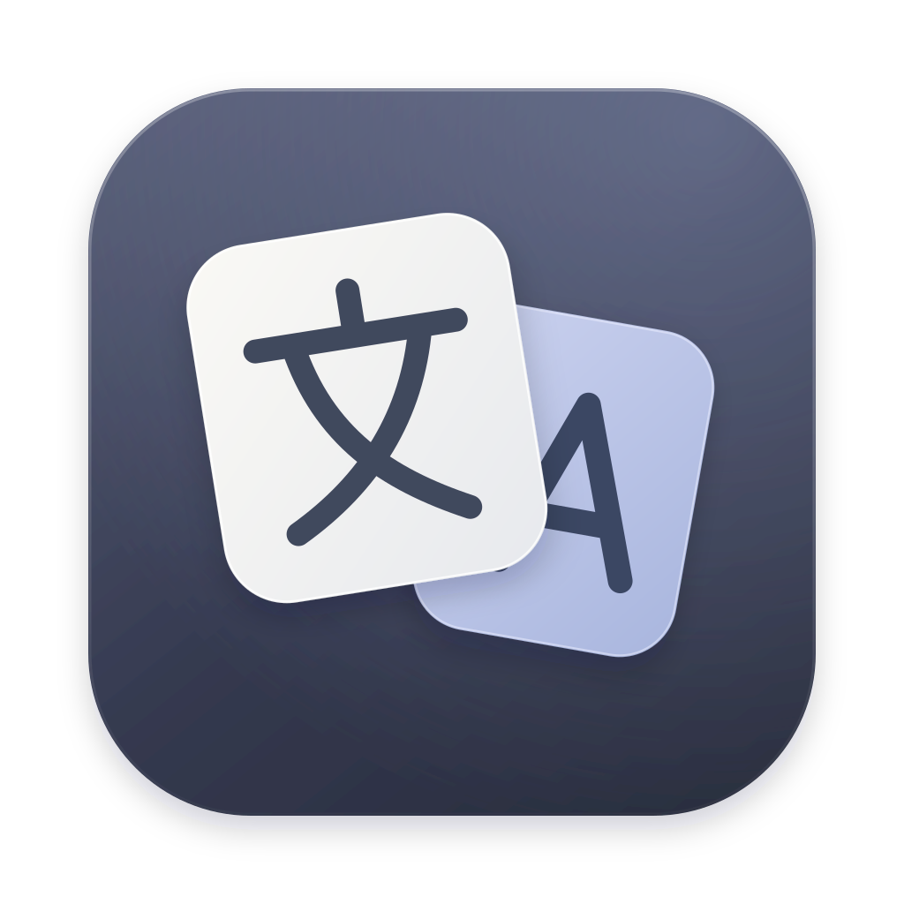
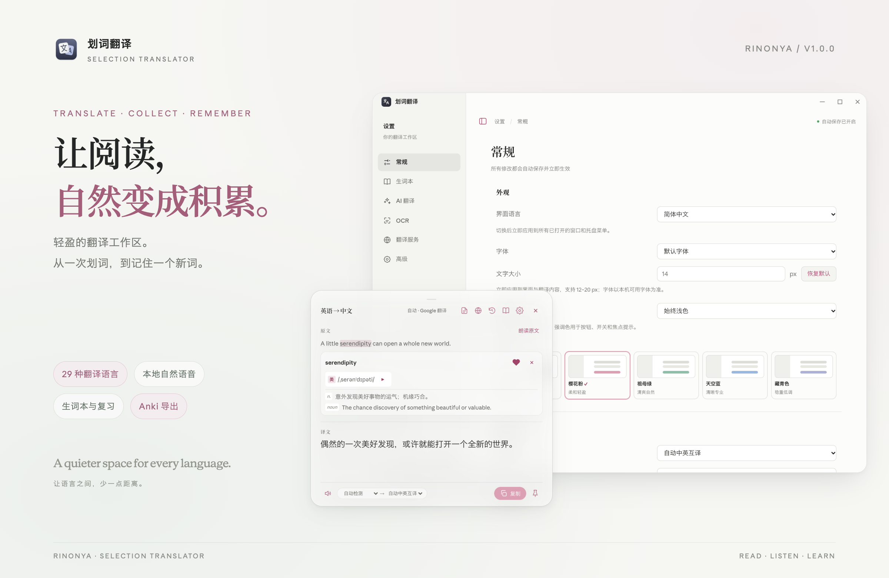
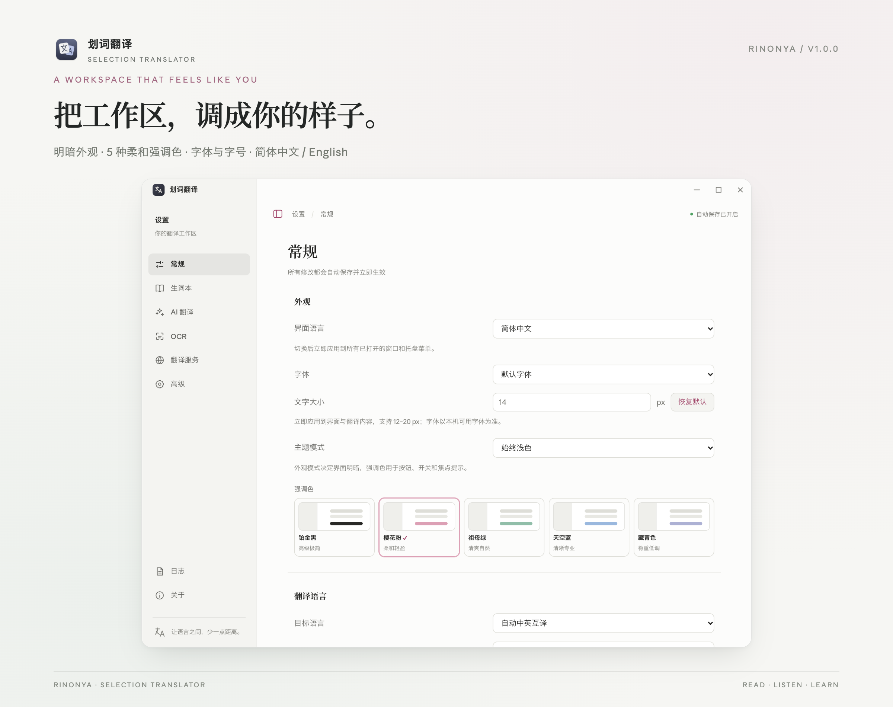
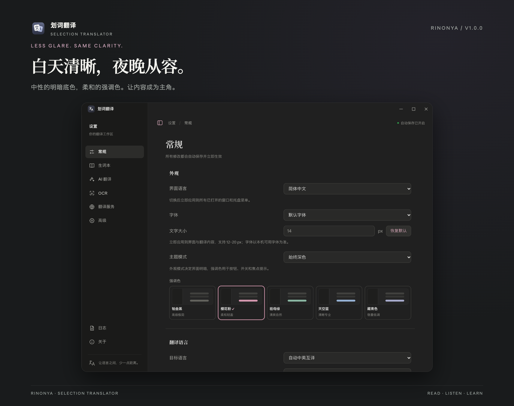
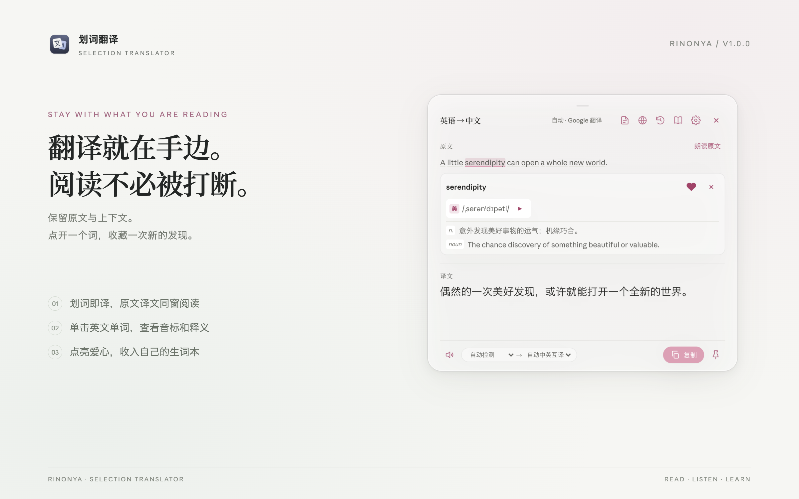
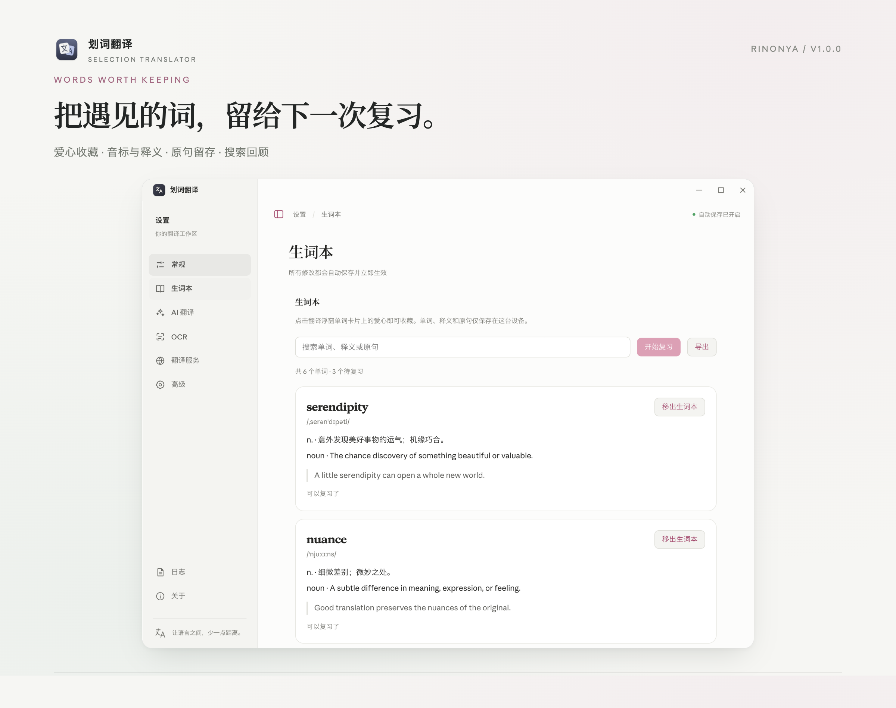
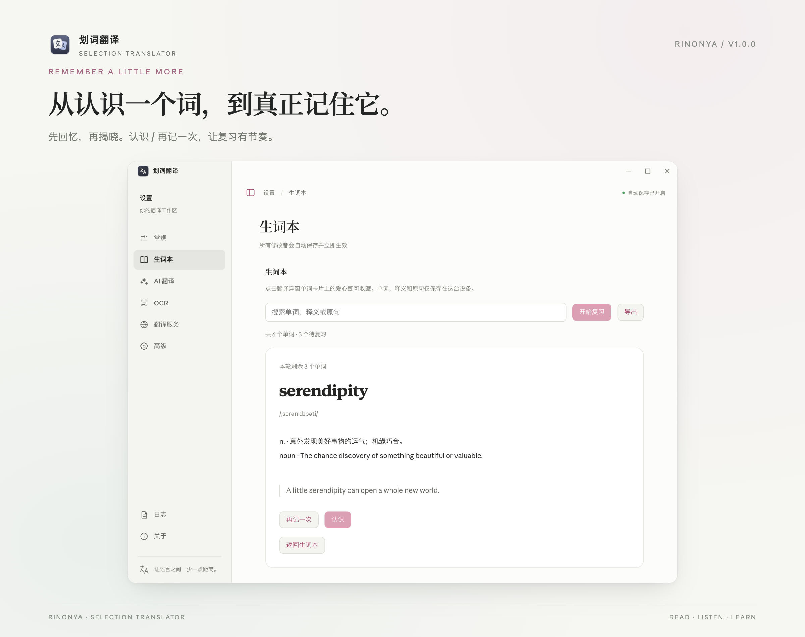
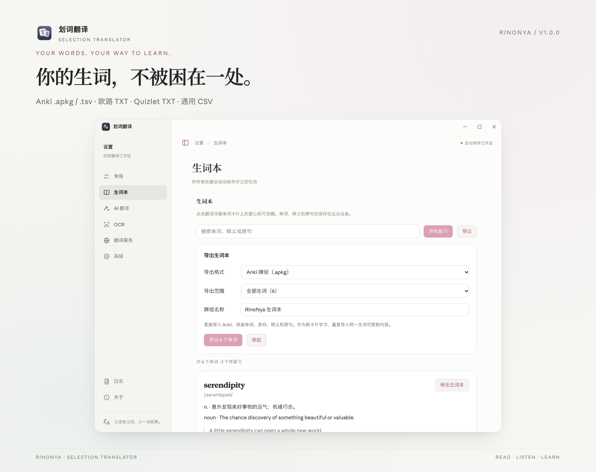
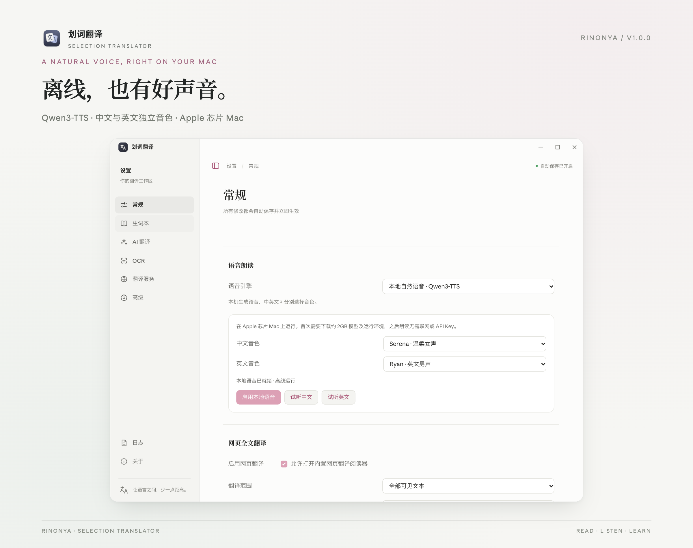

<div align="center">



# Selection Translator

**Translate in place. Keep the words that stay with you.**

A desktop translation workspace maintained by RinoNya. Select, translate, save a word, and come back to it when you are ready to learn.

**English** · [简体中文](./README.zh-CN.md)

[](./package.json) [](#quick-start) [](./package.json) [](https://github.com/Tadasuki/translation/stargazers)

[Interface](#a-quieter-workspace) · [Vocabulary](#save-the-word-keep-the-context) · [Local speech](#natural-speech-without-a-cloud-api) · [Quick start](#quick-start) · [Documentation](#documentation)

</div>



Meet an unfamiliar expression in a browser, paper, PDF, or editor. Select it and read the translation nearby. Save a useful word with a heart, together with its pronunciation, meaning, and original sentence. Review it here, or take your vocabulary to Anki, Eudic, or another learning tool.

Built on [zhenghq’s open-source Selection Translator](https://github.com/zhq734/translation), this edition is maintained by [RinoNya](https://github.com/Tadasuki), with a redesigned interface, local natural speech, a vocabulary notebook, spaced review, and portable exports.

## A quieter workspace

Neutral surfaces, soft accent colors, clear groups, and a collapsible sidebar. Settings and the translation popup share a consistent design. On macOS, Settings and the reader use native traffic-light controls, while the floating translator stays compact.



| Make it yours | Options |
| --- | --- |
| Interface language | Simplified Chinese, English, or follow the system |
| Translation languages | 29 built-in language choices and automatic Chinese/English direction; provider support varies |
| Appearance | System, light, or dark |
| Accent colors | Platinum, Sakura, Emerald, Sky, and Navy; applied to buttons, focus, and other emphasis |
| Typography | Default, system, serif, or monospace; 12–20 px, applied to the interface and translations |



## Stay with what you are reading

Choose automatic translation, a selection-side translation button, or shortcut-only mode. The popup keeps source text, translation, and the actual provider together, with language switching, speech, copy, pinning, and recent history.

Click an English word for pronunciation and definitions. Tap the heart to save it with its sentence.



> Screenshots use sample content and show only the application window. Window controls, available fonts, and translucent materials vary by operating system. The interface is shown in Simplified Chinese; English is also available.

## Save the word. Keep the context.

Open **Settings → Vocabulary** to revisit the words you discover.

- **Heart to save:** add or remove a word from its popup card, without creating duplicates.
- **Context included:** keep phonetics, meanings, and the sentence where you found it.
- **Search later:** search words, definitions, and context. The notebook stays on this device.
- **Spaced review:** recall first, then reveal the meaning. “Remembered” extends the interval; “Learn again” brings the word back in 10 minutes.





### Take your words with you

Open **Vocabulary → Export**, choose all words or the current search results, and save a file.

| Format | Use it for |
| --- | --- |
| **Anki `.apkg`** | Import a ready-made deck with words, phonetics, meanings, and context; repeat imports can update existing notes |
| **Anki `.tsv`** | Import into a Basic note type, with the first column on the front and the second on the back |
| **Eudic / plain `.txt`** | One word per line, for vocabulary import or text-based word selection such as Maimemo cloud wordbooks |
| **Quizlet `.txt`** | Paste into the website’s set importer, using tabs between terms and definitions |
| **Universal `.csv`** | Edit or map the Word, Phonetics, Meaning, and Context columns |

Anki imports start as new cards; local review history is not transferred. Plain word lists use the target app’s dictionary. Choose APKG, TSV, or CSV when you want to keep your saved definitions and context. See the [export guide](./docs/vocabulary-export.md).



## Natural speech, without a cloud API

Choose **Local natural voice · Qwen3-TTS** under **Settings → General → Speech**.

- Currently supports **Apple silicon Macs**, with a one-time download of approximately **2GB** for the model and isolated runtime.
- After setup, synthesis runs on your device with **no API key**.
- Choose Chinese and English voices independently. Defaults are **Serena / Ryan**, with preview buttons.
- Background warm-up, streamed playback, repeat-speech caching, and cancellation help keep playback responsive.
- System speech and optional Edge online speech remain available for other platforms and preferences.

A cold start needs time to load and warm the model. Playback is faster once the status reads “Local speech ready.” See the [local speech guide](./docs/local-speech.md).



## The original tools, still here

| Capability | What it does |
| --- | --- |
| Global selection and manual translation | Capture text from apps that support system copy, or translate up to 5000 characters in the input window |
| Screenshot and clipboard OCR | Recognize image text with native recognition, local Paddle OCR, or Tesseract |
| Full-page and bilingual reading | Extract and translate page text in the built-in reader, restore the original, and recognize page images |
| Multiple providers | AI, DingTalk, Microsoft, self-hosted/public DeepLX, Google, and MyMemory, with provider selection and fallback |
| AI translation | Ollama, OpenAI-compatible, and Anthropic Messages-compatible protocols |
| Translation history | The latest 200 successful translations, saved locally, with search, copy, and clear |
| Everyday controls | Shortcuts, pinning, auto-hide, clipboard protection, proxy settings, and diagnostics |

## Quick start

The current source version is **v1.0.0**. Use **Node.js 20+**. Building the native macOS helpers requires Xcode Command Line Tools.

```bash
git clone https://github.com/Tadasuki/translation.git
cd translation
npm ci
npm run dev
```

On macOS, grant Accessibility permission when prompted to enable global selection capture. The application lives in the menu bar or tray; open Settings there, or use the manual translation shortcut.

```bash
npm run typecheck   # TypeScript checks
npm test            # Unit tests
npm run build       # Build main, preload, and renderer
```

Packaging examples:

```bash
npm run dist:mac:unsigned  # Unsigned macOS test build
npm run dist:win           # Windows installer
npm run dist:linux         # Linux AppImage
```

Download the matching installer from [Releases](https://github.com/Tadasuki/translation/releases/tag/v1.0.0). The installer and in-app updater use this repository. See the [installation and release guide](./docs/guide.en.md) for platform-specific steps and SHA-256 verification.

## Documentation

| Guide | Contents |
| --- | --- |
| [Installation, configuration, and releases](./docs/guide.en.md) | Retained installation, permissions, providers, packaging, signing, updates, and troubleshooting details |
| [Local natural speech](./docs/local-speech.md) | Model setup, voices, offline operation, and resource management |
| [Vocabulary exports](./docs/vocabulary-export.md) | Anki, Eudic, Quizlet, CSV, and import steps |
| [Self-hosted DeepLX](./docs/deeplx-selfhost.md) | Local service and Docker configuration |
| [OCR models and benchmarks](./docs/ocr-model-benchmark.md) | Models, licensing, and validation notes |

## Your data

Vocabulary, review progress, and translation history stay on your device. There is no built-in account or cloud sync. Export creates local files and does not upload them to a third-party account.

Local TTS processes spoken text on-device. Online translation, dictionary lookup, and optional Edge speech contact their respective providers. AI keys and enterprise credentials are handled by the main process and stored separately using system secure storage. See the [privacy reference](./docs/guide.en.md#privacy-and-security).

## Authors and thanks

**Maintained by [RinoNya](https://github.com/Tadasuki)** · Contact: [Rino8bit@gmail.com](mailto:Rino8bit@gmail.com)

**Original author: [zhenghq](https://github.com/zhq734/translation)**. Thank you for the cross-platform selection, translation, OCR, and reader foundations, and to Electron, Qwen3-TTS, MLX Audio, and the other open-source projects behind this application.

The project retains its [MIT](./package.json) license declaration. Third-party models, dictionaries, and services have their own licenses and terms.
