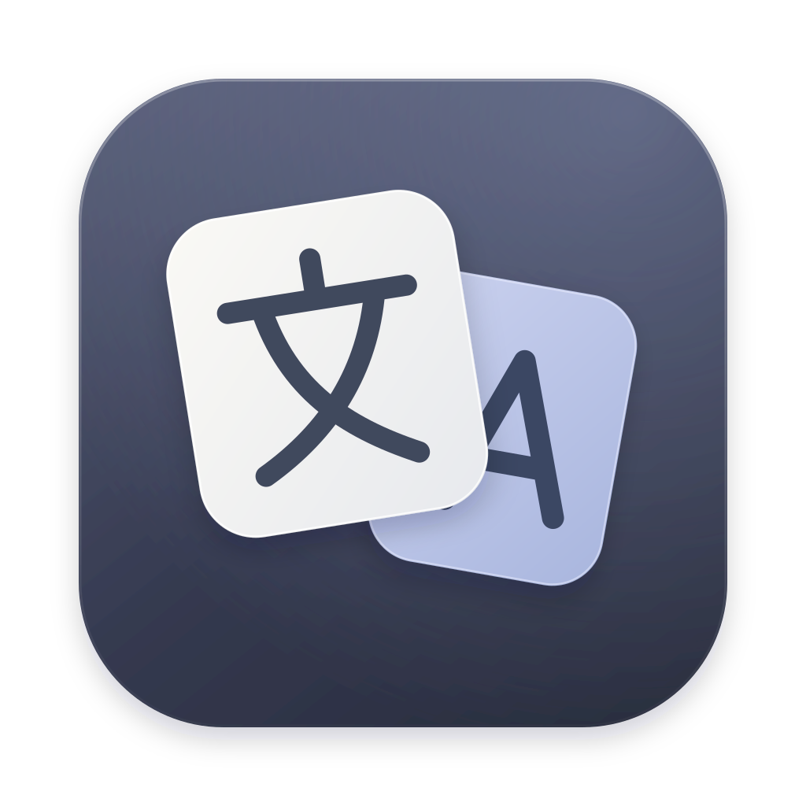
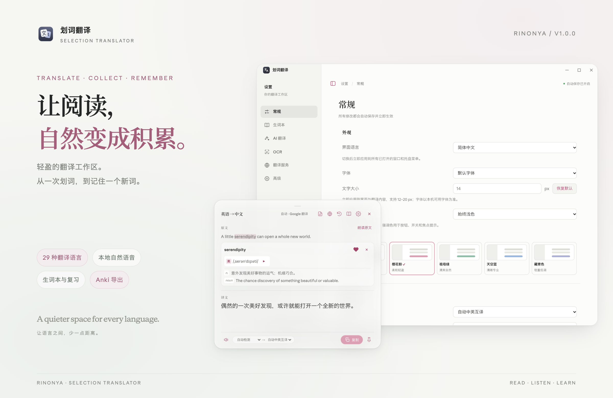
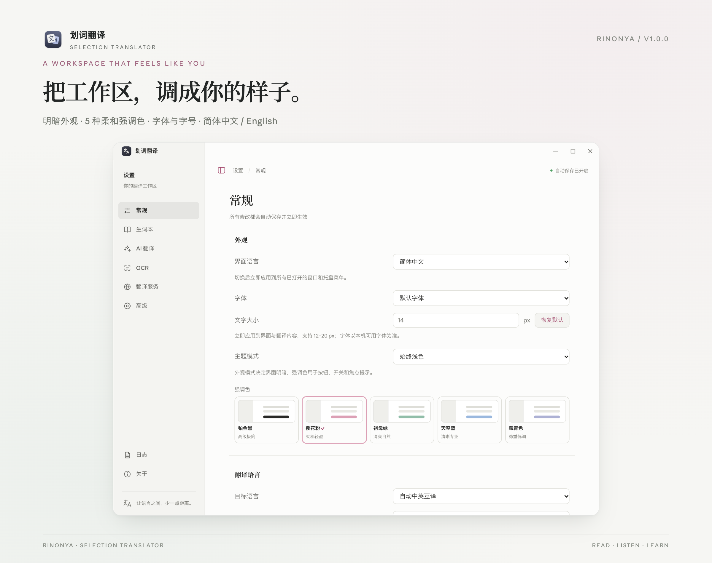
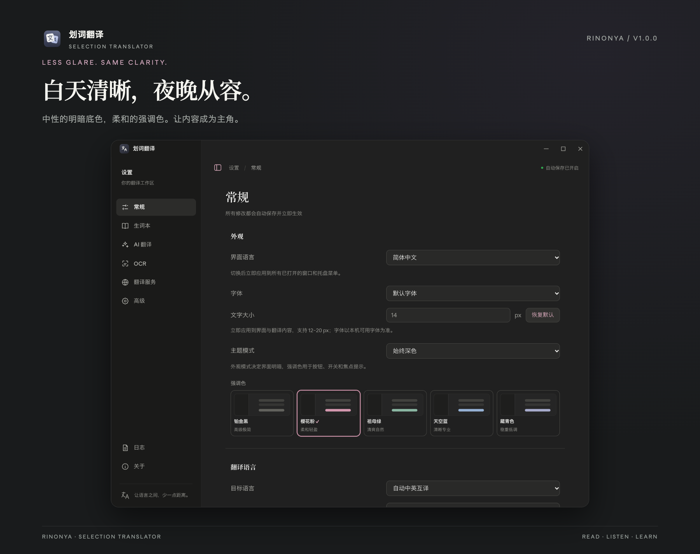
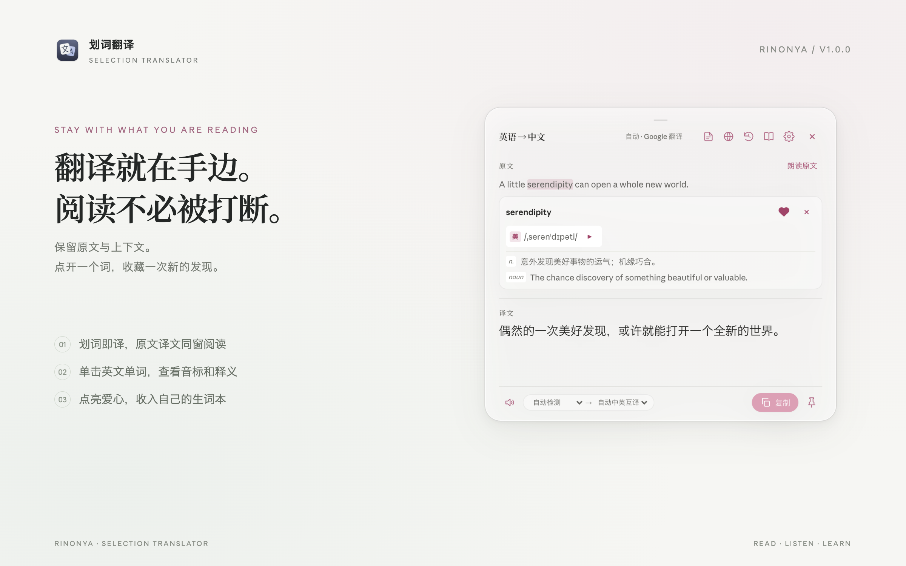
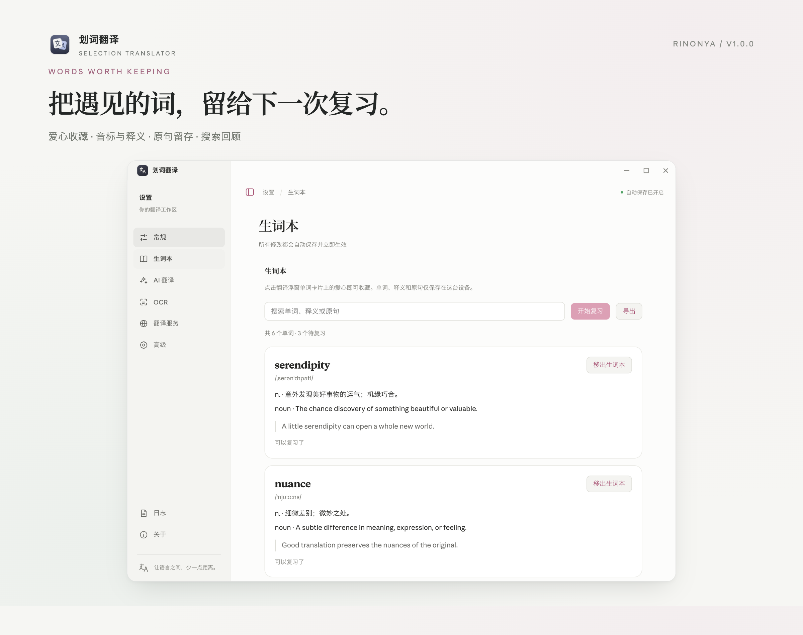
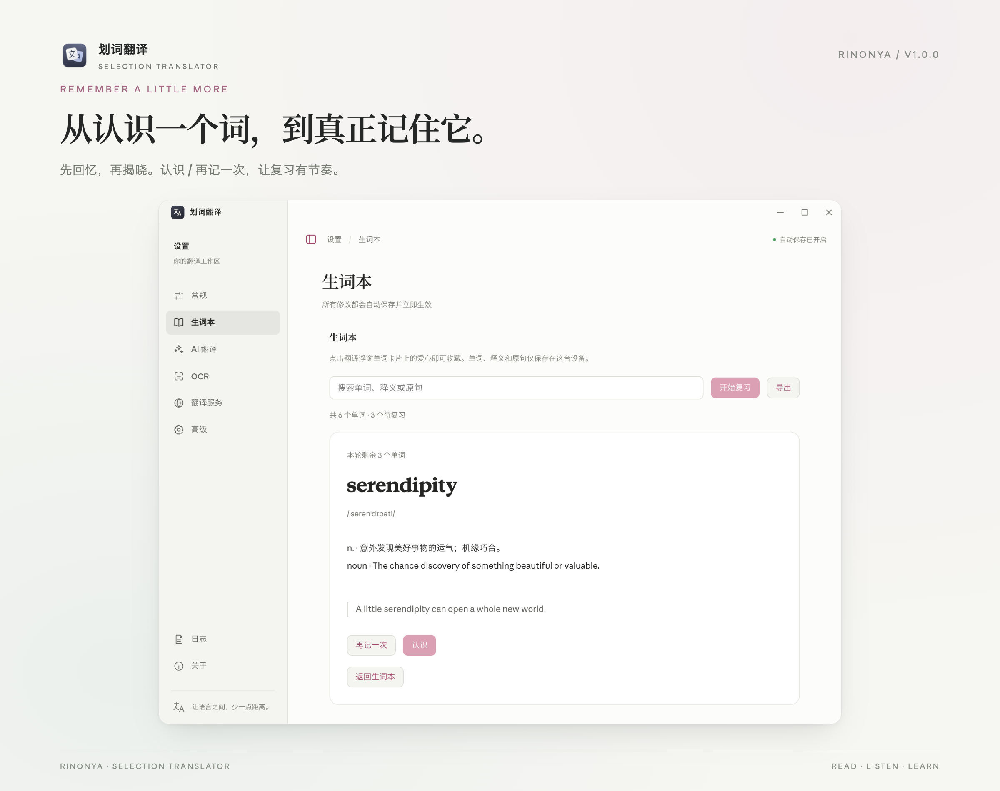
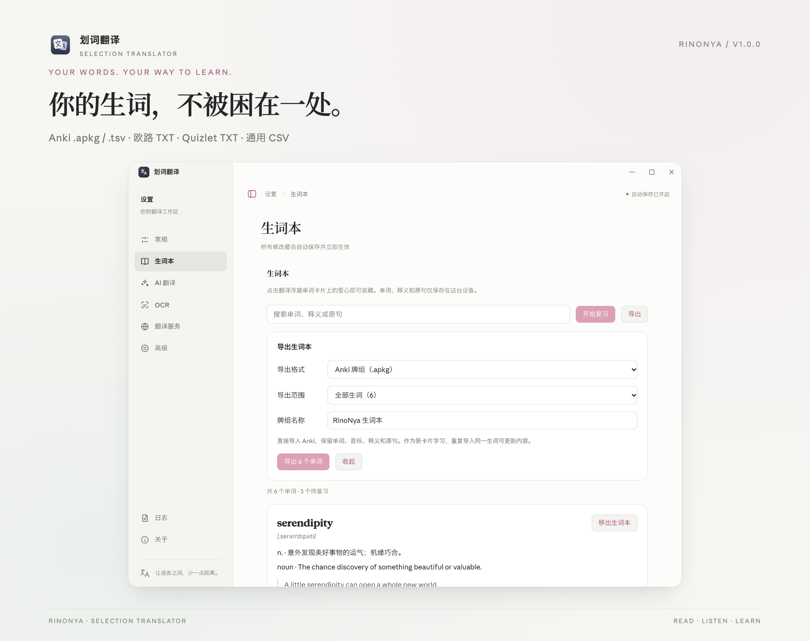
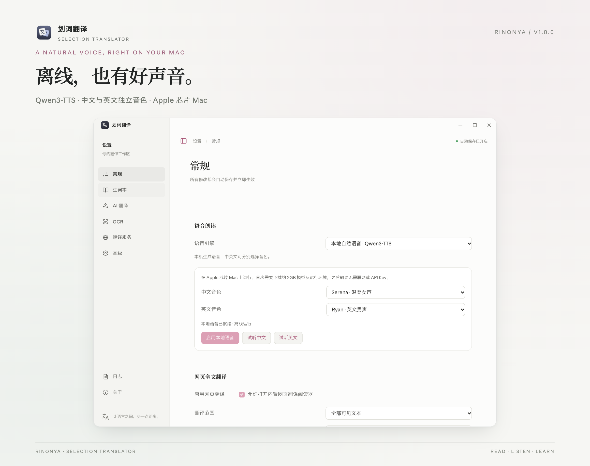

<div align="center">



# 划词翻译 · Selection Translator

**读懂每一句，记住每个词。**

一款由 RinoNya 维护的桌面翻译工具。划词即译，随手收藏，再把新词带进自己的复习节奏。

[English](./README.md) · **简体中文**

[](./package.json) [](#快速开始) [](./package.json) [](https://github.com/Tadasuki/translation/stargazers)

[界面一览](#界面一览) · [生词本](#生词本从收藏到记住) · [本地语音](#本地语音离线也有好声音) · [快速开始](#快速开始) · [详细文档](#详细文档)

</div>



在浏览器、论文、PDF 或编辑器里遇到陌生表达，选中它，在附近读到译文。遇见值得记住的单词，再点一次爱心，留下音标、释义和原句。需要集中复习时打开生词本，也可以导入 Anki、欧路或自己的背词工具。

本软件基于 [zhenghq 的开源「划词翻译」](https://github.com/zhq734/translation) 制作，由 [RinoNya](https://github.com/Tadasuki) 继续维护，重新设计了界面，并加入本地自然语音、生词本、间隔复习与多格式导出等功能。

## 界面一览

### 给阅读留一点安静的空间

中性的灰白底色、柔和的强调色、清晰的分组和可收起侧栏。设置页与浮窗使用统一的界面语言；macOS 设置页和阅读器使用原生红黄绿窗口按钮，翻译浮窗保持轻巧。



| 可以调整 | 选择 |
| --- | --- |
| 界面语言 | 简体中文、English，也可跟随系统 |
| 翻译语言 | 内置 29 种语言选择，支持自动中英互译；实际支持范围取决于翻译通道 |
| 外观 | 跟随系统、浅色、深色 |
| 强调色 | 铂金黑、樱花粉、祖母绿、天空蓝、藏青色；改变按钮与焦点等强调色 |
| 字体与字号 | 默认、系统、衬线、等宽；12–20 px，即时应用到界面和翻译内容 |



### 划词即译，原文与译文同窗阅读

支持自动翻译、选区旁显示翻译按钮、仅快捷键三种触发方式。浮窗保留原文、译文和实际翻译通道，支持切换语言、朗读、复制、固定窗口和查看最近的翻译记录。

点击英文单词即可展开音标与释义，点亮爱心，把这个词和所在句子一起收藏。



> 图中均为当前软件界面的演示内容，仅截取软件窗口。窗口按钮、字体可用性和半透明材质随操作系统变化。

## 生词本：从收藏到记住

在 **设置 → 生词本** 中，回看阅读时遇到的词。

- **爱心收藏**：在浮窗单词卡片中加入或移出生词本，重复收藏不会创建重复词条。
- **上下文留存**：同时保存单词、音标、释义和当时的原句。
- **搜索回顾**：按单词、释义或原句搜索；所有记录保存在当前设备。
- **间隔复习**：先回忆，再显示释义。选择“认识”逐步延长复习间隔；选择“再记一次”，10 分钟后再遇见它。





### 你的生词，可以带走

进入 **生词本 → 导出**，选择全部生词或当前搜索结果，再保存到本机。

| 导出格式 | 适合什么场景 |
| --- | --- |
| **Anki `.apkg`** | 直接导入牌组，保留单词、音标、释义和原句；重复导入可更新原卡片 |
| **Anki `.tsv`** | 以基础笔记类型导入，第一列为正面，第二列为背面 |
| **欧路 / 通用 `.txt`** | 每行一个单词，用于生词本导入或墨墨云词本等文本选词入口 |
| **Quizlet `.txt`** | 在网页版创建学习集时粘贴导入，术语与释义以制表符分隔 |
| **通用 `.csv`** | 保留 Word、Phonetics、Meaning、Context 四列，便于编辑或映射字段导入 |

Anki 卡片从新卡片开始学习，不复制本机复习历史。TXT 词表由目标软件匹配词库；需要保留自定义释义与原句时，选择 APKG、TSV 或 CSV。详见[导出与导入说明](./docs/vocabulary-export.md)。



## 本地语音：离线，也有好声音

在 **设置 → 常规 → 语音朗读** 中选择 **本地自然语音 · Qwen3-TTS**。

- 当前支持 **Apple 芯片 Mac**，首次下载模型与独立运行环境约需 **2GB** 磁盘空间。
- 下载完成后，语音在本机生成，**无需 API Key**。
- 中文和英文分别选择音色，默认 **Serena / Ryan**，可以直接试听。
- 支持后台预热、流式播放、重复朗读缓存，以及停止和切换文本时取消旧请求。
- 仍保留系统语音与 Edge 在线语音选项，供其他平台或不同需求使用。

冷启动需要加载与预热；显示“本地语音已就绪”后再播放更快。详见[本地语音说明](./docs/local-speech.md)。



## 原有能力，继续保留

| 能力 | 说明 |
| --- | --- |
| 全局划词与手动翻译 | 在支持系统复制的应用中取词，也可打开输入窗口翻译最多 5000 个字符 |
| 截图与剪贴板 OCR | 使用系统识别、本地 Paddle OCR 或 Tesseract 识别图片文字 |
| 网页全文与双语阅读 | 内置阅读器，提取正文、全文翻译、切换原文与译文，并可识别页面图片文字 |
| 多翻译通道 | AI、钉钉、微软、自建与公共 DeepLX、Google、MyMemory；提供通道选择与降级机制 |
| AI 翻译 | 支持 Ollama、OpenAI 兼容和 Anthropic Messages 兼容协议 |
| 翻译记录 | 本机保存最近 200 条成功翻译，可搜索、复制和清空 |
| 日常使用 | 快捷键、图钉、自动隐藏、剪贴板保护、代理设置与日志诊断 |

## 快速开始

当前源码版本为 **v1.0.0**。使用 **Node.js 20+**；macOS 本地构建原生辅助程序需要 Xcode Command Line Tools。

```bash
git clone https://github.com/Tadasuki/translation.git
cd translation
npm ci
npm run dev
```

首次使用 macOS 全局划词功能时，按提示授予应用辅助功能权限。应用常驻菜单栏 / 托盘，从那里打开设置；也可以使用手动翻译快捷键。

```bash
npm run typecheck   # TypeScript 检查
npm test            # 单元测试
npm run build       # 构建主进程、预加载脚本与界面
```

打包示例：

```bash
npm run dist:mac:unsigned  # 未签名 macOS 测试包
npm run dist:win           # Windows 安装包
npm run dist:linux         # Linux AppImage
```

从 [Releases](https://github.com/Tadasuki/translation/releases/tag/v1.0.0) 下载匹配系统的安装包。一键安装与应用内更新均指向本仓库；各平台安装及 SHA-256 校验方式见[安装与发布指南](./docs/guide.zh-CN.md)。

## 详细文档

| 文档 | 内容 |
| --- | --- |
| [安装、配置与发布](./docs/guide.zh-CN.md) | 原项目的完整安装、权限、服务配置、打包、签名、更新与排错说明 |
| [本地自然语音](./docs/local-speech.md) | 模型下载、音色、离线运行与资源管理 |
| [生词本导出](./docs/vocabulary-export.md) | Anki、欧路、Quizlet 与 CSV 的导出和导入方式 |
| [自建 DeepLX](./docs/deeplx-selfhost.md) | 本地服务与 Docker 配置 |
| [OCR 模型与基准](./docs/ocr-model-benchmark.md) | OCR 模型配置、许可与验证记录 |

## 数据与隐私

生词本、复习进度和翻译记录保存在本机，没有内置账号或云同步。导出操作只生成本地文件，不会自动上传到第三方账号。

本地 TTS 的朗读文本在设备内处理；联网翻译、词典查询和可选 Edge 语音会调用对应第三方服务。AI API Key 和企业凭证由主进程通过系统安全存储单独保存。更多细节见[配置与隐私参考](./docs/guide.zh-CN.md#隐私与安全)。

## 作者与致谢

**维护者：[RinoNya](https://github.com/Tadasuki)** · 联系邮箱：[Rino8bit@gmail.com](mailto:Rino8bit@gmail.com)

**原作者：[zhenghq](https://github.com/zhq734/translation)**。感谢原项目提供的跨平台划词、翻译、OCR 与阅读器基础，也感谢 Electron、Qwen3-TTS、MLX Audio 及相关开源项目。

本项目沿用 [MIT](./package.json) 许可证声明；第三方模型、词典和服务遵循各自的许可与使用条款。
