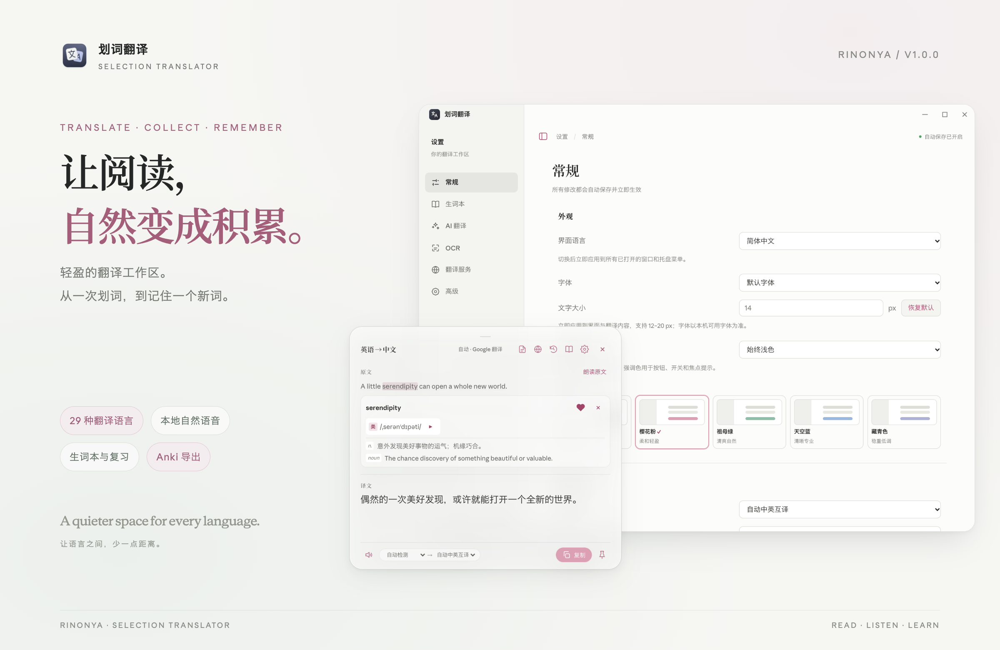

# V1.0.0 · RinoNya



读懂每一句，记住每个词。基于 zhenghq 的开源「划词翻译」制作，由 **RinoNya** 维护。

## 这一版

- 重新设计设置页、翻译浮窗与图标，提供明暗外观、五种柔和强调色、字体和字号设置。
- 支持简体中文 / English 界面、29 种翻译语言选择和自动中英互译。
- 点击英文单词查看音标和释义，用爱心收藏进生词本，同时保留原句。
- 新增生词搜索与间隔复习，支持 Anki `.apkg` / `.tsv`、欧路 TXT、Quizlet TXT 和 CSV 导出。
- 新增 Qwen3-TTS 本地自然语音：Apple 芯片 Mac 可下载模型后离线使用，中文与英文分别选择音色。
- 保留全局划词、手动翻译、截图及剪贴板 OCR、网页全文和双语阅读、AI 与多通道翻译、本机翻译记录等功能。
- 安装脚本、更新检查与下载源已改为 `Tadasuki/translation`。

## 选哪个安装包？

| 系统 | 选择 |
| --- | --- |
| Apple 芯片 Mac | 文件名包含 `mac-arm64.dmg`，打开后拖入“应用程序” |
| Intel Mac | 文件名包含 `mac-x64.dmg` |
| Windows 10 / 11 普通电脑 | 文件名包含 `Setup-x64.exe` |
| Windows ARM64 | 文件名包含 `Setup-arm64.exe` |
| Windows 自动选择架构 | `SelectionTranslator-1.0.0-Setup.exe` 通用安装包，体积较大 |
| Linux x64 | 对应 x64 / x86_64 的 `.AppImage`；增加执行权限后运行 |
| Linux ARM64 | 对应 arm64 的 `.AppImage` |
| Windows 7 SP1 x64 | 单独的 `Setup-win7-x64.exe` 兼容包；不适用于 32 位系统 |

macOS `.zip` 是应用压缩包，日常安装优先选择 `.dmg`。`latest*.yml`、`.blockmap` 和 `build-info.json` 为更新组件使用，不是安装包。

## 安装与语音

- 首次使用 macOS 全局划词功能时，需要按提示授予辅助功能权限。
- 本次没有配置商业签名与 Apple 公证凭据。macOS 包使用 ad-hoc 签名、未经 Apple 公证；Windows 安装包未配置商业代码签名。系统可能显示来源确认提示。确认文件来自本仓库并完成校验后，请按[安装指南](https://github.com/Tadasuki/translation/blob/v1.0.0/docs/guide.zh-CN.md)处理。
- 本地 Qwen3-TTS 目前仅支持 Apple 芯片 Mac。模型与独立运行环境约 2GB，首次在“设置 → 常规 → 语音朗读”中下载，不包含在安装包里。Windows、Linux 与 Intel Mac 保留系统和 Edge 语音选项。
- 所有生词本、复习进度与翻译记录保存在当前设备；导出不会自动上传到其他账号。

## 校验下载

`SHA256SUMS` 包含本次各安装包的 SHA-256 摘要。下载对应安装包与校验文件后，可在同一文件夹中执行：

```bash
# Linux
sha256sum --ignore-missing -c SHA256SUMS

# macOS：仅检查你下载的文件
shasum -a 256 SelectionTranslator-1.0.0-mac-arm64.dmg
```

Windows PowerShell：

```powershell
Get-FileHash .\SelectionTranslator-1.0.0-Setup-x64.exe -Algorithm SHA256
```

将结果与 `SHA256SUMS` 中对应文件的值比较。

[完整介绍与截图](https://github.com/Tadasuki/translation/blob/v1.0.0/README.zh-CN.md) · [生词本导出](https://github.com/Tadasuki/translation/blob/v1.0.0/docs/vocabulary-export.md) · [本地语音](https://github.com/Tadasuki/translation/blob/v1.0.0/docs/local-speech.md)

维护者：[RinoNya](https://github.com/Tadasuki) · [Rino8bit@gmail.com](mailto:Rino8bit@gmail.com)<br>
原作者：[zhenghq](https://github.com/zhq734/translation)
